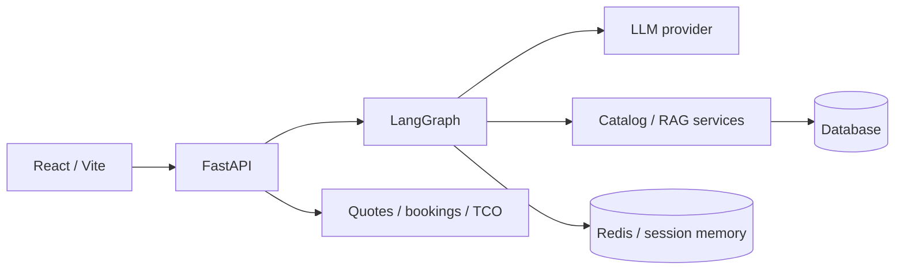

# VinCar AI

Ứng dụng tư vấn xe VinFast qua hội thoại, kết hợp danh mục xe, so sánh thông số, tính chi phí sở hữu, yêu cầu báo giá và đặt lịch lái thử. Backend dùng FastAPI và LangGraph, frontend dùng React, TypeScript và Vite.


## Chức năng

- Khám phá nhu cầu, lọc xe theo tiêu chí và so sánh xe trong hội thoại.
- Truy xuất danh mục bằng SQL và thông tin bổ sung qua lớp RAG.
- Phản hồi chat theo luồng SSE và lưu trạng thái hội thoại.
- Tính TCO, yêu cầu báo giá, lịch lái thử và các màn hình quản lý khách hàng.

## Kiến trúc



| Thư mục | Vai trò |
|---|---|
| `frontend/` | Giao diện khách hàng và quản trị |
| `src/agents/` | Graph, node, prompt và trạng thái agent |
| `src/api/` | API chat, danh mục, tài khoản và nghiệp vụ |
| `src/services/` | Dữ liệu, tìm kiếm, bộ nhớ và LLM |
| `scripts/` | Chuẩn bị và nạp dữ liệu |
| `tests/` | Kiểm thử ứng dụng |
| `eval/` | Dataset, bộ chạy đánh giá và báo cáo |

## Cài đặt local

Dùng Python 3.11 và Node.js 20, tương ứng các môi trường trong Dockerfile. Chạy từ thư mục gốc repo.

```powershell
git clone https://github.com/daotrunghieuk4/VinCar-AI.git
cd VinCar-AI
python -m venv .venv
.venv\Scripts\Activate.ps1
python -m pip install -r requirements.txt
Copy-Item .env.example .env
```

Trên Linux/macOS, kích hoạt bằng `source .venv/bin/activate` và sao chép cấu hình bằng `cp .env.example .env`.

Điền cấu hình trong `.env` theo môi trường sử dụng.

| Biến | Mục đích |
|---|---|
| `OPENAI_API_KEY`, `MODEL_NAME` | Provider và model cho hội thoại |
| `DATABASE_URL` | Cơ sở dữ liệu SQLAlchemy async, mặc định local dùng SQLite |
| `SUPABASE_URL`, `SUPABASE_KEY` | Kết nối các dịch vụ Supabase khi sử dụng |
| `REDIS_URL` | Redis cho bộ nhớ/checkpoint |
| `SECRET_KEY` | Khóa ký token riêng cho môi trường chạy |

Khởi tạo dữ liệu và chạy backend với cấu hình trỏ vào database local dành cho demo. Script seed có ghi dữ liệu, vì vậy cần kiểm tra `DATABASE_URL` trước khi chạy.

```powershell
python -m scripts.seed_cars
python -m uvicorn src.main:app --reload --port 8000
```

Script `seed_cars` cung cấp dữ liệu mẫu ô tô. Các nguồn dữ liệu khác và các bước nạp dữ liệu nằm trong `scripts/`; chức năng RAG đầy đủ cần catalog/vector database tương ứng.

Mở terminal thứ hai cho frontend.

```powershell
cd frontend
npm ci
npm run dev
```

Giao diện local ở `http://localhost:5173`, API docs ở `http://localhost:8000/docs` và health check ở `http://localhost:8000/health`. Frontend dùng `VITE_API_URL` khi cần thay địa chỉ API.

## Docker

Sau khi chuẩn bị `.env`, có thể chạy backend, frontend và Redis bằng cấu hình development.

```bash
docker compose -f docker-compose.dev.yml up --build -d
docker compose -f docker-compose.dev.yml logs -f
```

## Kiểm thử và đánh giá

```bash
python -m pytest tests -q
python eval/run_benchmark.py --help
```

Frontend có các lệnh `npm run typecheck`, `npm run lint` và `npm run build`.

Một báo cáo retrieval lưu trong repo ghi nhận kết quả sau trên 20 ca kiểm tra.

| Chỉ số | Giá trị |
|---|---:|
| Số ca được chấm | 20 |
| Số ca lỗi | 0 |
| Mean final vehicle recall | 1.00 |
| Mean final chunk recall | 0.85 |

Đây là kết quả đã lưu của bộ kiểm tra retrieval. Chất lượng phản hồi hội thoại phụ thuộc thêm vào model, prompt và dữ liệu tại thời điểm chạy. [Kết quả JSON](eval/reports/rag_retrieval_report.json) · [Hướng dẫn đánh giá](eval/README.md)

## Phạm vi demo

Dữ liệu xe và thông tin trong báo cáo phản ánh snapshot của dự án. Cấu hình local có tài khoản seed và các giá trị mặc định phục vụ phát triển; khi triển khai cần cấu hình khóa riêng và kiểm tra chính sách tài khoản. Các báo cáo cũ được giữ trong repo để đối chiếu thí nghiệm.
