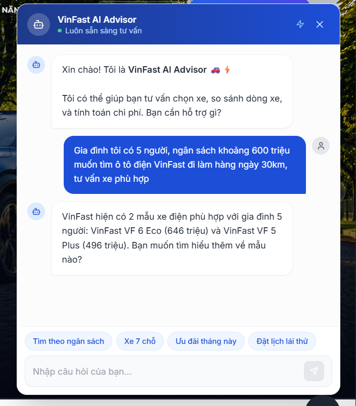
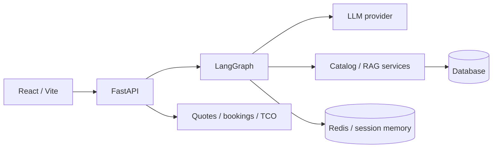

# VinCar AI

Ứng dụng tư vấn xe VinFast qua hội thoại, kết hợp danh mục xe, so sánh thông số, tính chi phí sở hữu, yêu cầu báo giá và đặt lịch lái thử. Backend dùng FastAPI và LangGraph, frontend dùng React, TypeScript và Vite.



## Tổng quan

VinCar AI tổ chức quá trình tư vấn mua xe thành một luồng hội thoại: tiếp nhận nhu cầu, tra cứu danh mục, giải thích lựa chọn và hỗ trợ các bước tiếp theo như so sánh, tính chi phí hoặc đăng ký lái thử. Dự án kết nối giao diện web với các công cụ dữ liệu và dịch vụ nghiệp vụ để người dùng có thể khám phá thông tin xe trong cùng một phiên làm việc.

Phần agent được xây dựng bằng LangGraph, cho phép biểu diễn trạng thái và các bước xử lý của hội thoại. FastAPI cung cấp lớp API, còn React và TypeScript đảm nhiệm trải nghiệm tương tác trên trình duyệt. Các thành phần được tách theo vai trò để thuận tiện cho việc đọc mã, kiểm thử và mở rộng công cụ tư vấn.

## Chức năng

- Khám phá nhu cầu, lọc xe theo tiêu chí và so sánh xe trong hội thoại.
- Truy xuất danh mục bằng SQL và thông tin bổ sung qua lớp RAG.
- Phản hồi chat theo luồng SSE và lưu trạng thái hội thoại.
- Tính TCO, yêu cầu báo giá, lịch lái thử và các màn hình quản lý khách hàng.

## Kiến trúc



| Thư mục | Vai trò |
|---|---|
| `frontend/` | Giao diện khách hàng và quản trị |
| `src/agents/` | Graph, node, prompt và trạng thái agent |
| `src/api/` | API chat, danh mục, tài khoản và nghiệp vụ |
| `src/services/` | Dữ liệu, tìm kiếm, bộ nhớ và LLM |
| `scripts/` | Chuẩn bị và nạp dữ liệu |
| `tests/` | Kiểm thử ứng dụng |
| `eval/` | Dataset, bộ chạy đánh giá và báo cáo |

## Luồng sử dụng

1. Mở giao diện và nhập nhu cầu, chẳng hạn ngân sách, số chỗ hoặc mục đích sử dụng xe.
2. Tiếp tục hội thoại để làm rõ tiêu chí và xem các lựa chọn trong danh mục.
3. Yêu cầu so sánh thông số hoặc tìm thông tin bổ sung cho mẫu xe quan tâm.
4. Sử dụng các chức năng chi phí sở hữu, báo giá hoặc lịch lái thử theo nhu cầu.

Trong quá trình này, frontend nhận phản hồi theo luồng SSE. Backend điều phối agent và các dịch vụ tra cứu; dữ liệu có cấu trúc phục vụ truy vấn danh mục, còn lớp RAG hỗ trợ tìm nội dung liên quan tới câu hỏi.

## Cài đặt local

Dùng Python 3.11 và Node.js 20, tương ứng các môi trường trong Dockerfile. Chạy từ thư mục gốc repo.

```powershell
git clone https://github.com/daotrunghieuk4/VinCar-AI.git
cd VinCar-AI
python -m venv .venv
.venv\Scripts\Activate.ps1
python -m pip install -r requirements.txt
Copy-Item .env.example .env
```

Trên Linux/macOS, kích hoạt bằng `source .venv/bin/activate` và sao chép cấu hình bằng `cp .env.example .env`.

Điền cấu hình trong `.env` theo môi trường sử dụng.

| Biến | Mục đích |
|---|---|
| `OPENAI_API_KEY`, `MODEL_NAME` | Provider và model cho hội thoại |
| `DATABASE_URL` | Cơ sở dữ liệu SQLAlchemy async, mặc định local dùng SQLite |
| `SUPABASE_URL`, `SUPABASE_KEY` | Kết nối các dịch vụ Supabase khi sử dụng |
| `REDIS_URL` | Redis cho bộ nhớ/checkpoint |
| `SECRET_KEY` | Khóa ký token riêng cho môi trường chạy |

Khởi tạo dữ liệu và chạy backend với cấu hình trỏ vào database local dành cho demo. Script seed có ghi dữ liệu, vì vậy cần kiểm tra `DATABASE_URL` trước khi chạy.

```powershell
python -m scripts.seed_cars
python -m uvicorn src.main:app --reload --port 8000
```

Script `seed_cars` cung cấp dữ liệu mẫu ô tô. Các nguồn dữ liệu khác và các bước nạp dữ liệu nằm trong `scripts/`; chức năng RAG đầy đủ cần catalog/vector database tương ứng.

Mở terminal thứ hai cho frontend.

```powershell
cd frontend
npm ci
npm run dev
```

Giao diện local ở `http://localhost:5173`, API docs ở `http://localhost:8000/docs` và health check ở `http://localhost:8000/health`. Frontend dùng `VITE_API_URL` khi cần thay địa chỉ API.

## Docker

Sau khi chuẩn bị `.env`, có thể chạy backend, frontend và Redis bằng cấu hình development.

```bash
docker compose -f docker-compose.dev.yml up --build -d
docker compose -f docker-compose.dev.yml logs -f
```

## Kiểm thử và đánh giá

```bash
python -m pytest tests -q
python eval/run_benchmark.py --help
```

Frontend có các lệnh `npm run typecheck`, `npm run lint` và `npm run build`.

Một báo cáo retrieval lưu trong repo ghi nhận kết quả sau trên 20 ca kiểm tra.

| Chỉ số | Giá trị |
|---|---:|
| Số ca được chấm | 20 |
| Số ca lỗi | 0 |
| Mean final vehicle recall | 1.00 |
| Mean final chunk recall | 0.85 |

Đây là kết quả đã lưu của bộ kiểm tra retrieval. Chất lượng phản hồi hội thoại phụ thuộc thêm vào model, prompt và dữ liệu tại thời điểm chạy. [Kết quả JSON](eval/reports/rag_retrieval_report.json) · [Hướng dẫn đánh giá](eval/README.md)

## Dữ liệu và cấu hình triển khai

Dữ liệu danh mục được khởi tạo qua script seed, giúp thiết lập một môi trường chạy thống nhất. Khi bổ sung hoặc cập nhật xe, cần đồng bộ dữ liệu danh mục và nội dung được lập chỉ mục để kết quả tra cứu phản ánh cùng một phiên bản dữ liệu.

Môi trường phát triển sử dụng các tài khoản seed để thử nghiệm luồng nghiệp vụ. Với môi trường triển khai riêng, thiết lập khóa ký token, thông tin kết nối và chính sách tài khoản tương ứng. Quản lý khóa API qua biến môi trường và sử dụng database dành riêng cho từng môi trường.

## Đọc và mở rộng mã nguồn

- Bắt đầu từ `src/main.py` để tìm hiểu cách khởi tạo ứng dụng và đăng ký API.
- Xem `src/agents/` để theo dõi trạng thái và các bước điều phối hội thoại.
- Xem `src/services/` khi thay đổi cách truy xuất dữ liệu hoặc kết nối dịch vụ.
- Dùng `tests/` và `eval/` để đối chiếu hành vi sau khi cập nhật prompt, công cụ hoặc danh mục.

Khi báo cáo kết quả đánh giá, ghi kèm cấu hình model, phiên bản dữ liệu và bộ câu hỏi. Các báo cáo trong `eval/` cung cấp nguồn đối chiếu cho từng phép đo; chỉ số retrieval được diễn giải trong phạm vi bài kiểm tra truy xuất tương ứng.

## Xử lý cấu hình thường gặp

| Hiện tượng | Nội dung cần kiểm tra |
|---|---|
| Frontend không gọi được backend | Backend đang chạy, cổng API và `VITE_API_URL` |
| Danh mục chưa có dữ liệu | `DATABASE_URL` và bước chạy script seed |
| Dịch vụ hội thoại báo lỗi provider | Khóa API, tên model và khả năng kết nối provider |
| Không khôi phục được trạng thái hội thoại | Cấu hình Redis và dịch vụ bộ nhớ đang sử dụng |
